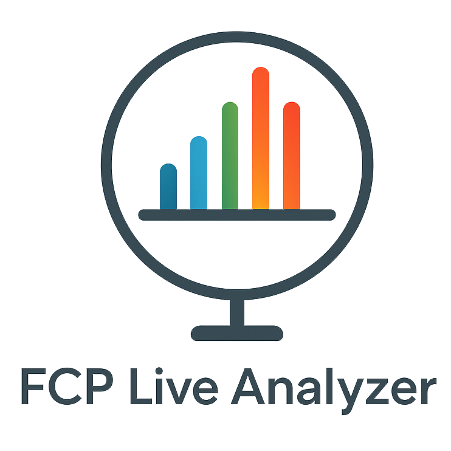
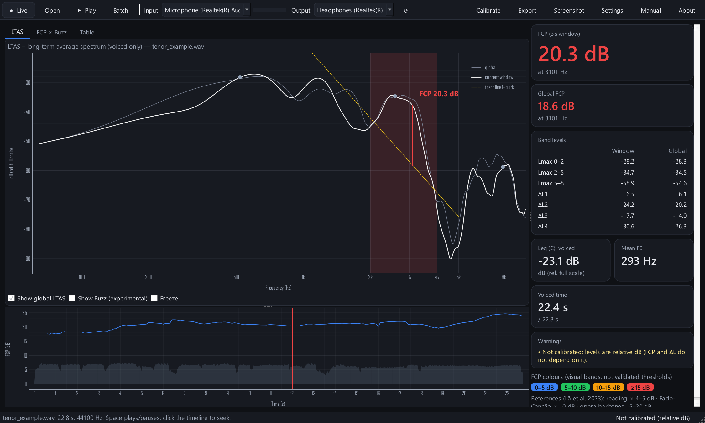
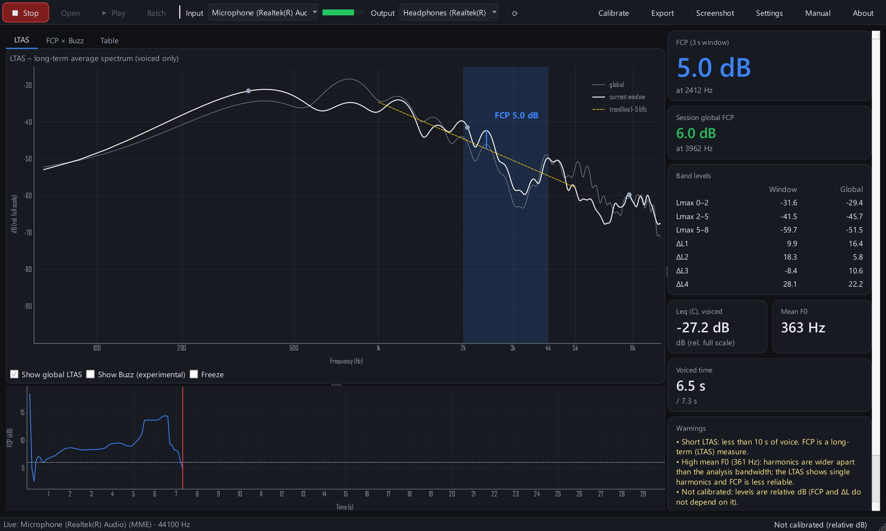

# FCP Live Analyzer 2.0



Scientific software for live and offline measurement of the **Formant Cluster Prominence (FCP)**, the
singer's-formant measure of Lã, Silva & Granqvist (2023), and the LTAS band measures of the same paper
(Lmax, ΔL1–ΔL4). Current version: **2.0.0**.

**Author: Tiago Lima Bicalho Cruz — Universidade Federal de Minas Gerais (UFMG), Brazil.**

This is a research and teaching tool. FCP colour bands are visual aids, not validated thresholds, and the
measure does not apply to sustained vowels (Lã et al., 2023).

[Português brasileiro](README.pt-BR.md) · [English manual](docs/Manual_FCP_Live_Analyzer_EN.pdf) · [Manual em português](docs/Manual_FCP_Live_Analyzer_pt-BR.pdf) · [Changes](CHANGELOG.md)



## What it measures

| Measure | Definition (Lã et al., 2023) |
| --- | --- |
| LTAS | Long-term average spectrum of the voiced segments; Hanning window, 350 Hz bandwidth, power average |
| **FCP** | Largest difference between the LTAS and a trendline fitted between 1 and 5 kHz (linear in log frequency), inside 2–4 kHz |
| Lmax(0–2), Lmax(2–5), Lmax(5–8) | Maximum LTAS level per band (kHz) |
| ΔL1 / ΔL2 / ΔL3 / ΔL4 | Lmax(0–2)−Lmax(2–5) / Lmax(2–5)−Lmax(5–8) / ΔL1−ΔL2 / Lmax(0–2)−Lmax(5–8) |
| Leq (C) | C-weighted level of the voice, in dB SPL @ 30 cm when calibrated |
| Buzz (experimental) | Author's own measure, **not validated**: 90th percentile of the LTAS in 5–8 kHz minus the trendline at 5 kHz |

## Capabilities

- **Live mode**: incremental LTAS and FCP (≈ 4 ms per update, 10 updates/s), session-global FCP in real time;
  the take is saved, re-analysed and exported when you stop.
- **Files with synchronised playback**: LTAS, cards and cursor follow the audio stream position (minus device
  latency); click the timeline to jump anywhere.
- **Batch analysis** of many files in the background, with progress and cancel.
- **dB SPL calibration** with a reference tone and 30 cm distance normalisation, as in the paper.
- Automatic warnings: short LTAS, sustained vowel/note, high F0, clipping, low sample rate.
- FCP × Buzz scatter, full numeric table, CSV/PNG export with every setting recorded.
- PySide6 + pyqtgraph interface, **English by default**, Brazilian Portuguese available.



## Validation

65 automatic tests (`python -m pytest tests`), including synthetic signals with known FCP, the ΔL values of
Tables 2–4 of Lã et al. (2023), Praat's `To Ltas`, live-equals-file consistency and **agreement with Sopran**,
the program used in the paper:

| File | Sopran FCP | App FCP | Sopran slope | App slope |
| --- | --- | --- | --- | --- |
| noise with 3 kHz cluster | 10.15 dB | 10.16 dB | −11.488 dB/oct | −11.485 dB/oct |
| noise without cluster | 0.04 dB | 0.06 dB | −12.100 | −12.100 |
| tenor example | 18.47 dB | 18.49 dB | −22.449 | −22.458 |
| rock example | 2.93 dB | 2.95 dB | −9.206 | −9.207 |

## Download and run

- **Windows**: installer from the Releases / Actions artifacts, or run from source.
- **macOS**: `.dmg` built by the GitHub Actions workflow (unsigned: right-click > Open the first time).
- **From source** (Python 3.10+):

```bash
pip install -r requirements.txt
python main.py [recording.wav]
```

## License and citation

Apache License 2.0 — see [LICENSE](LICENSE) and [NOTICE](NOTICE). Redistributions and derivative works must keep
the NOTICE file and credit the author. Please cite the software ([CITATION.cff](CITATION.cff)) and:

Lã FMB, Silva LS, Granqvist S. Long-term average spectrum characteristics of Portuguese Fado-Canção from Coimbra.
*Journal of Voice* 37(4):631.e7–631.e15, 2023.
