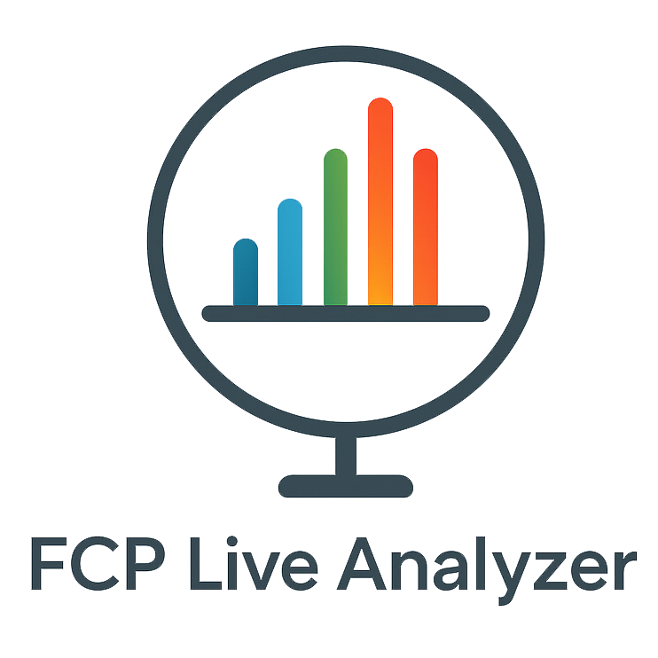
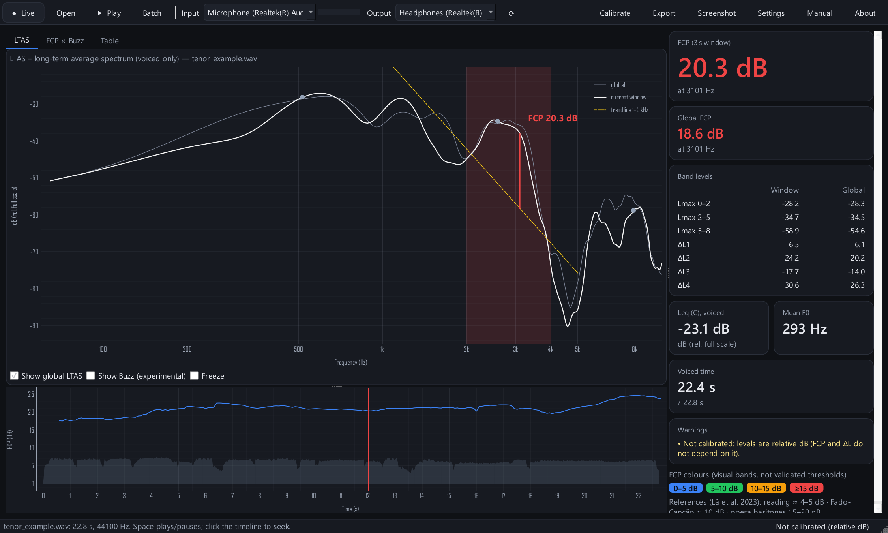
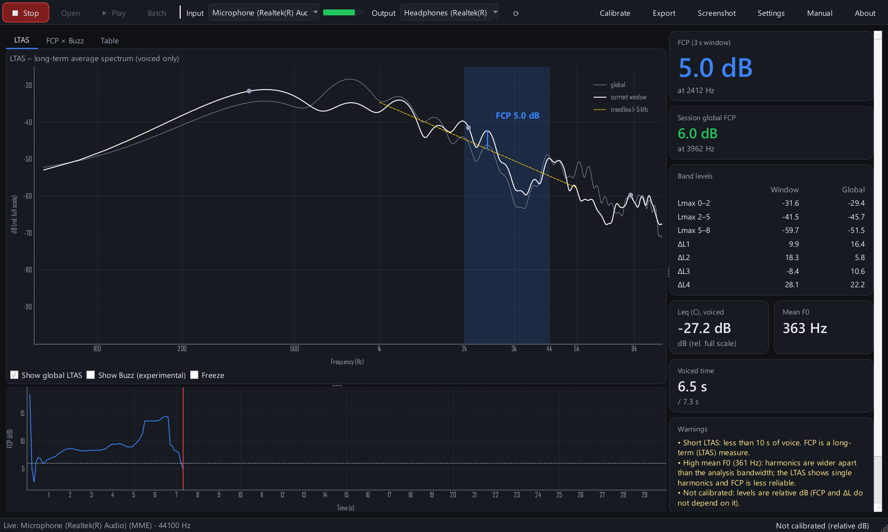

# FCP Live Analyzer 2.0



Software científico para medir, ao vivo ou em arquivos, a **Formant Cluster Prominence (FCP)**, a medida do
formante do cantor proposta por Lã, Silva e Granqvist (2023), e as medidas de banda do LTAS do mesmo artigo
(Lmax, ΔL1–ΔL4). Versão atual: **2.0.0**.

**Autor: Tiago Lima Bicalho Cruz — Universidade Federal de Minas Gerais (UFMG), Brasil.**

Ferramenta de pesquisa e ensino. As cores do FCP são apoio visual, não limiares validados, e a medida não se
aplica a vogais sustentadas (Lã et al., 2023).

[English](README.md) · [Manual em português](docs/Manual_FCP_Live_Analyzer_pt-BR.pdf) · [English manual](docs/Manual_FCP_Live_Analyzer_EN.pdf) · [Mudanças](CHANGELOG.md)



## O que mede

| Medida | Definição (Lã et al., 2023) |
| --- | --- |
| LTAS | Espectro médio de longo termo dos trechos vozeados; janela Hanning, banda de 350 Hz, média em potência |
| **FCP** | Maior diferença entre o LTAS e uma reta ajustada entre 1 e 5 kHz (linear em log da frequência), dentro de 2–4 kHz |
| Lmax(0–2), Lmax(2–5), Lmax(5–8) | Nível máximo do LTAS em cada banda (kHz) |
| ΔL1 / ΔL2 / ΔL3 / ΔL4 | Lmax(0–2)−Lmax(2–5) / Lmax(2–5)−Lmax(5–8) / ΔL1−ΔL2 / Lmax(0–2)−Lmax(5–8) |
| Leq (C) | Nível da voz com ponderação C, em dB SPL a 30 cm quando calibrado |
| Buzz (experimental) | Medida própria do autor, **não validada**: percentil 90 do LTAS em 5–8 kHz menos a reta em 5 kHz |

## Recursos

- **Ao vivo**: LTAS e FCP incrementais (≈ 4 ms por atualização, 10 por segundo) e FCP global da sessão em tempo
  real; ao parar, a gravação é salva, reanalisada e exportada.
- **Arquivos com reprodução sincronizada**: o LTAS, os cartões e o cursor seguem a posição real do áudio
  (descontada a latência); clique na linha do tempo para ir a qualquer ponto.
- **Análise em lote** em segundo plano, com progresso e cancelamento.
- **Calibração em dB SPL** com tom de referência e normalização para 30 cm, como no artigo.
- Avisos automáticos: LTAS curto, vogal/nota sustentada, F0 alto, clipping, taxa de amostragem baixa.
- Gráfico FCP × Buzz, tabela numérica completa, exportação CSV/PNG com todas as configurações registradas.
- Interface PySide6 + pyqtgraph, **em inglês por padrão**, com português do Brasil disponível.



## Validação

65 testes automáticos (`python -m pytest tests`): sinais sintéticos com FCP conhecido, os ΔL das Tabelas 2–4 de
Lã et al. (2023), o `To Ltas` do Praat, consistência entre ao vivo e arquivo e **concordância com o Sopran**,
o programa usado no artigo:

| Arquivo | FCP Sopran | FCP app | Inclinação Sopran | Inclinação app |
| --- | --- | --- | --- | --- |
| ruído com cluster em 3 kHz | 10,15 dB | 10,16 dB | −11,488 dB/oit | −11,485 dB/oit |
| ruído sem cluster | 0,04 dB | 0,06 dB | −12,100 | −12,100 |
| exemplo de tenor | 18,47 dB | 18,49 dB | −22,449 | −22,458 |
| exemplo de rock | 2,93 dB | 2,95 dB | −9,206 | −9,207 |

## Baixar e executar

- **Windows**: instalador nos Releases / artefatos do Actions, ou pelo código-fonte.
- **macOS**: `.dmg` gerado pelo workflow do GitHub Actions (sem assinatura: botão direito > Abrir na primeira vez).
- **Código-fonte** (Python 3.10+):

```bash
pip install -r requirements.txt
python main.py [gravacao.wav]
```

## Licença e citação

Apache License 2.0 — veja [LICENSE](LICENSE) e [NOTICE](NOTICE). Redistribuições e trabalhos derivados devem manter
o arquivo NOTICE e dar crédito ao autor. Cite o software ([CITATION.cff](CITATION.cff)) e:

Lã FMB, Silva LS, Granqvist S. Long-term average spectrum characteristics of Portuguese Fado-Canção from Coimbra.
*Journal of Voice* 37(4):631.e7–631.e15, 2023.
