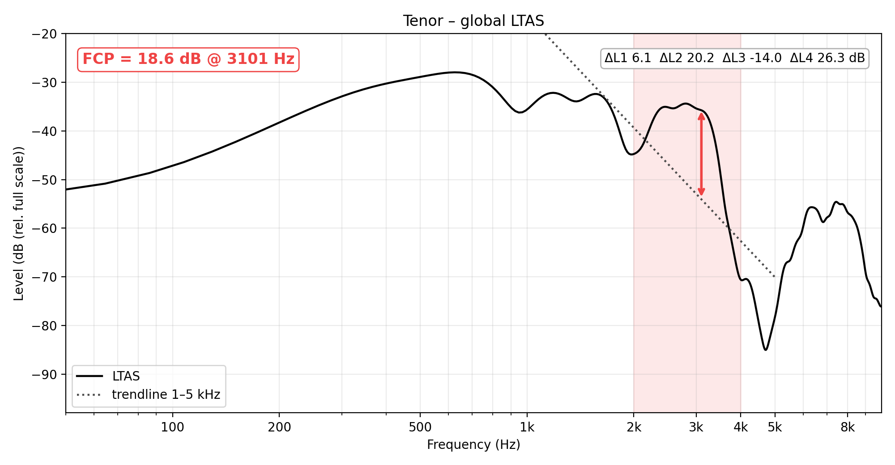
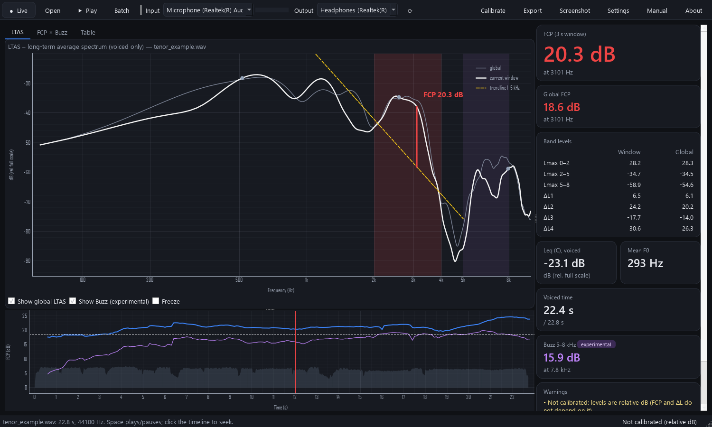
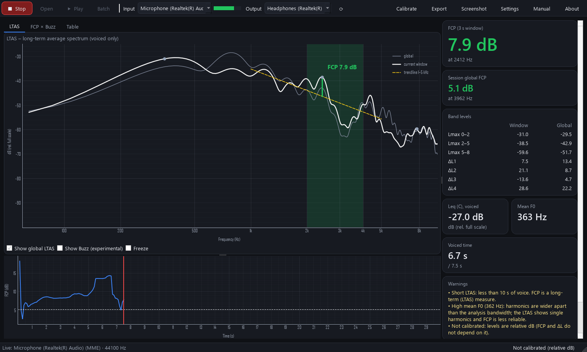

# FCP Live Analyzer 2.0 — User manual

Tiago Lima Bicalho Cruz · version 2.0.0 · November 2026

FCP Live Analyzer measures, live or from files, the **Formant Cluster Prominence (FCP)**: how much the
clustering of resonances R3–R5 (the "singer's formant") stands out in the long-term average spectrum (LTAS)
of the voice. It follows the definition of Lã, Silva and Granqvist (2023) and also reports the band measures of
the same paper (Lmax and ΔL1–ΔL4).

## 1. What the program measures

| Measure | Definition (Lã et al., 2023) |
| --- | --- |
| LTAS | Long-term average spectrum of the voiced segments only. Hanning window, 350 Hz bandwidth, power average. |
| Trendline | Line fitted to the LTAS between 1 and 5 kHz, linear in log frequency (straight on a logarithmic axis, as in the paper's figures). |
| **FCP** | **Largest difference between the LTAS and the trendline inside 2–4 kHz.** The frequency where it occurs is also reported. |
| Lmax(0–2), Lmax(2–5), Lmax(5–8) | Maximum LTAS level in each band (kHz). |
| ΔL1 | Lmax(0–2) − Lmax(2–5) (Hammarberg index) |
| ΔL2 | Lmax(2–5) − Lmax(5–8) |
| ΔL3 | ΔL1 − ΔL2 |
| ΔL4 | Lmax(0–2) − Lmax(5–8) |
| Leq (C) | C-weighted equivalent level of the voice. In dB SPL when the system is calibrated. |
| Buzz (experimental) | The author's own measure, **not validated in the literature**: 90th percentile of the LTAS in the Buzz band (5–8 kHz by default) minus the trendline evaluated at 5 kHz. |

Published reference values (Lã et al., 2023): reading aloud ≈ 4–5 dB; sung Fado-Canção ≈ 10 dB
(3.7 to 14.3 dB across singers); two opera baritones 14.8 and 20 dB.

**Important.** FCP is an LTAS measure. The authors state it does not apply to sustained vowels.
Use running singing, preferably with at least 10 s of voice.

## 2. Installing and running

* **Executable (Windows):** unzip `FCP_Live_Analyzer_2.0.0_win64.zip` and open
  `FCP_Live_Analyzer\FCP_Live_Analyzer.exe`. Python is not required.
* **Source code:** with Python 3.10 or newer, run `pip install -r requirements.txt`, then `python main.py`.
  You can also open a file directly: `python main.py recording.wav`.

Supported formats: WAV, FLAC, AIFF, OGG and MP3. Stereo files are averaged to mono.
To measure up to 8 kHz, use a sample rate of 16 kHz or more (44.1 or 48 kHz recommended).

## 3. The main window

1. **Toolbar:** Live/Stop, Open, Play/Pause, Batch, input (with level meter) and output devices, Calibrate,
   Export, Screenshot, Settings, Manual and About.
2. **LTAS tab:** white curve = LTAS of the current window; grey curve = global LTAS (whole file or session);
   dashed yellow line = 1–5 kHz trendline; coloured arrow = FCP; coloured band = 2–4 kHz;
   grey dots = Lmax of each band; lilac band = Buzz band (when enabled).
3. **Timeline:** FCP of each window (blue), Buzz (lilac, when enabled), global FCP (dashed), signal envelope
   (grey) and the red cursor. **Click anywhere to jump there.**
4. **Right panel:** window FCP, global FCP, table of Lmax and ΔL (window and global), Leq, mean F0, analysed
   voiced time, Buzz (when enabled) and **warnings** about the quality of the measure.
5. **FCP × Buzz tab:** scatter of all windows with the r coefficient. The red dot is the current window.
6. **Table tab:** every numeric value with its definition.

The **FCP colours** (blue < 5, green 5–10, orange 10–15, red ≥ 15 dB) are visual bands chosen from the values
in the paper. **They are not validated thresholds** for the "presence" of a singer's formant.

Shortcuts: **Space** play/pause, **←/→** back/forward 1 s, **Home** to the start, **Ctrl+O** open,
**Ctrl+L** live, **Ctrl+B** batch, **Ctrl+E** export, **F1** manual. You can also drop a file onto the window.

## 4. Live mode

1. Choose the microphone under **Input**. Check on the meter that the signal does not reach red (clipping).
2. Click **Live**. LTAS and FCP update 10 times per second, about 0.2 s behind the input.
3. The **FCP (3 s window)** card shows the last 3 s of voice. The **Session global FCP** card accumulates all
   voice since the start. To compare singers or tasks, use the global value.
4. Click **Stop**. The take is saved as `take.wav`, re-analysed with the same engine as file mode and exported to a
   `Live_YYYYMMDD_HHMMSS` folder. The take stays open for synchronised review.

Unvoiced parts (silence, voiceless consonants, breathing) are discarded automatically, as in the paper.

## 5. Files and synchronised playback

1. Click **Open** (or drop the file). Analysis runs in the background with a progress bar.
2. The global FCP of the file appears in the panel. The timeline shows the FCP of every 3 s window.
3. Click **Play**. LTAS, cards and cursor follow exactly what you hear: the position comes from the audio stream
   itself, minus the sound card latency. The window shown is the last 3 s heard.
4. While stopped, click the timeline to inspect any moment.
5. **Freeze** holds the plot while the audio keeps playing.

## 6. Batch analysis

Click **Batch** and select several files. The program creates a `Batch_YYYYMMDD_HHMMSS` folder with:

* `batch_summary.csv`: one row per file with the global values;
* `batch_windows.csv`: every window of every file;
* one sub-folder per file with `summary.csv`, `windows.csv`, `ltas_global.csv` and the plots
  `ltas_global.png`, `fcp_timeline.png` and `fcp_vs_buzz.png`.

A file that fails does not stop the batch: its row shows `ERROR` in the `warnings` column.

## 7. Calibration in dB SPL

FCP and ΔL are level differences and **do not depend on calibration**. Calibrate only if you want LTAS and Leq in
dB SPL, as in the paper:

1. Place the microphone and set the gain. Do not change the gain afterwards.
2. Play a steady tone (e.g. 1 kHz) near the microphone and measure its level with a sound level meter (Z or C weighting).
3. In **Calibrate**, enter the reading and click **Record 3 s from the microphone** (or use a WAV of the tone).
   The program computes the offset (dB SPL = 10·log10(power) + offset). You can also type the offset.
4. Enter the **mouth–microphone distance**. Levels are normalised to 30 cm with 20·log10(d/30).

The calibration is saved and only valid for the same microphone and gain. The program warns if you change the input.
Without calibration, levels are shown as "dB (rel. full scale)".

## 8. Settings

| Option | Default | Comment |
| --- | --- | --- |
| LTAS engine | Sopran-like | Hann window with 350 Hz bandwidth and power average; continuous curve (points every ~20 Hz). |
| | Praat-like | 40 ms frames, power average, then mean density in 350 Hz bands, like Praat's `To Ltas` (validated against Praat). |
| Bandwidth | 350 Hz | Value used in the paper. |
| Bandwidth definition | −6 dB | Hann window of 2·fs/B samples (5.714 ms at 350 Hz), exactly the window Sopran reports. Alternatives: −3 dB and ENBW. |
| Points used for the measures | Sopran grid | FCP, trendline and Lmax are computed on the same frequency points as Sopran (256-point FFT at 44.1 kHz, ~172 Hz), which reproduces Sopran's numbers. The "fine grid" (~20 Hz) locates the maximum more precisely but can read a few tenths of a dB higher. The plotted curve is always the fine one. |
| Dynamic FCP window | 3 s | Affects only the curve over time; the global value uses the whole file. |
| Voiced segments only | yes | Praat pitch detector (60–1200 Hz). |
| Buzz band | 5–8 kHz | Also 4–8 and 5–9 kHz. |
| Language | English | Changes when the program is reopened. |
| Exports folder | Documents\FCP Live Analyzer\Exports | |

## 9. Exported files

`summary.csv` and `batch_summary.csv` (one row per file):

| Column | Content |
| --- | --- |
| `duration_s`, `voiced_s` | Total duration and voiced time used in the LTAS |
| `level_unit` | Unit of the levels (dB SPL, dB SPL @30 cm or relative) |
| `Leq_C_voiced_dB`, `Leq_C_all_dB` | C-weighted Leq of the voice and of the whole file |
| `F0_mean_Hz`, `pitch_range_st` | Mean F0 (geometric) and F0 range (10th–90th percentile, semitones) |
| `FCP_dB`, `FCP_freq_Hz` | FCP and the frequency of the maximum |
| `Peak_2_4_dB`, `Peak_2_4_freq_Hz` | LTAS peak in 2–4 kHz |
| `FCP_at_peak_v1_dB` | Old definition (peak minus trend at the peak), only for comparison with v1.x |
| `Trend_slope_dB_per_oct`, `Trend_intercept_dB` | Trendline: level = slope·log2(f) + intercept |
| `Lmax_0_2_dB`, `Lmax_2_5_dB`, `Lmax_5_8_dB` | Band maxima |
| `dL1_dB` … `dL4_dB` | ΔL1–ΔL4 with the paper's signs |
| `Buzz_experimental_dB`, `Buzz_experimental_freq_Hz` | Buzz (experimental) |
| `windows_n`, `windows_FCP_mean_dB`, `windows_FCP_sd_dB`, `windows_r_FCP_Buzz` | Window statistics |
| `warnings`, `settings` | Warnings and every setting used (JSON), so the analysis can be reproduced |

`windows.csv` holds the same measures per window (`t_start_s`, `t_end_s`). `ltas_global.csv` lists the LTAS point by
point together with the trendline, ready for Excel or for comparison with Sopran.

## 10. Warnings and limits

| Warning | Meaning |
| --- | --- |
| Short LTAS | Less than 10 s of voice. FCP becomes sensitive to the vowels and notes of the excerpt. |
| Sustained vowel/note | F0 hardly varies (less than 2 semitones). The paper states FCP does not apply to sustained vowels. |
| High mean F0 | Above 350 Hz the harmonics are wider apart than the analysis bandwidth; the LTAS shows single harmonics (common in sopranos). |
| Clipping | More than 0.1 % of samples saturated; high frequencies are distorted. Lower the gain. |
| Low sample rate | Below 16 kHz the 5–8 kHz band is missing (Lmax(5–8), ΔL2–ΔL4 and Buzz are empty). |
| Not calibrated | Levels are relative; FCP and ΔL remain valid. |

Also: keep microphone distance and position constant, avoid background noise and reverberation, compare similar
tasks (FCP also varies with loudness and with ΔL1) and do not interpret 1–2 dB differences between days without
repeated measurements.

## 11. Validation

The `tests` folder holds automatic tests (run `python -m pytest tests`). Among them:

* synthetic signals with a known envelope: measured FCP matches the FCP of the theoretical LTAS (±0.5 dB) in both engines;
* invariance: gain and any tilt linear in log(f) do not change FCP;
* FCP is the maximum of LTAS − trendline, not the LTAS peak;
* the ΔL1–ΔL4 definitions reproduce Tables 2, 3 and 4 of the paper;
* the Praat-like engine matches Praat's own `To Ltas`;
* unvoiced parts are excluded; live mode gives the same result as file mode;
* calibration, 30 cm normalisation and C weighting;
* sample rates from 16 to 48 kHz give the same FCP.

**Comparison with Sopran** (the program used by Lã et al.). Whole-file LTAS in Sopran (Hanning, 350 Hz,
5.7143 ms window) and Sopran's own FCP report, compared with the app without unvoiced removal (as done in Sopran):

| File | Sopran FCP | App FCP | Sopran slope | App slope |
| --- | --- | --- | --- | --- |
| noise with a 3 kHz cluster | 10.15 dB | 10.16 dB | −11.488 dB/oct | −11.485 dB/oct |
| noise without cluster | 0.04 dB | 0.06 dB | −12.100 | −12.100 |
| tenor (example) | 18.47 dB | 18.49 dB | −22.449 | −22.458 |
| rock (example) | 2.93 dB | 2.95 dB | −9.206 | −9.207 |

The LTAS shape matches point by point (difference below 0.6 dB from 0.3 to 8 kHz). Two convention differences,
which affect neither FCP nor ΔL: (1) Sopran shows levels 6.02 dB below the app's (the app uses band level: a
−20 dBFS RMS sine reads −20 dB); (2) Sopran labels frequencies k·fs/255 instead of k·fs/256, so its FCP frequency
reads 0.4 % higher (3112.9 Hz instead of 3100.8 Hz). Data and script are in `validation/sopran` and
`tools/compare_sopran.py`; the test `tests/test_sopran.py` checks this agreement in every version.

## 12. Changes from version 1.2.1

| Item | v1.2.1 | v2.0 |
| --- | --- | --- |
| FCP definition | LTAS peak in 2–4 kHz minus the trendline at that peak | Maximum of (LTAS − trendline) in 2–4 kHz, as in the paper |
| LTAS | Mean of dB spectra, maximum inside 350 Hz bins | Power average with a 350 Hz Hann window (or Praat-like bands) |
| ΔL in CSV | Inverted signs; no ΔL3; "Delta_2_4" was just Lmax(2–4) | ΔL1–ΔL4 with the paper's signs |
| Level axis | Fixed +94 dB offset without real calibration | Reference-tone calibration, dB SPL at 30 cm, or relative dB |
| Live | Recomputed everything every update; after 20 s recomputed the whole signal | Incremental accumulation (~4 ms per update); session global in real time |
| Playback | Display driven by a timer, unrelated to the real audio position | Display driven by the audio stream position minus latency |
| Buzz | Several variants, ad hoc normalisation | One definition, labelled experimental, off by default |
| Sustained vowels | Example with a sustained vowel | Automatic warning |
| Interface | Tkinter + Matplotlib | PySide6 + pyqtgraph, Portuguese and English |
| License | Conflicting MIT and EULA | Apache 2.0 with NOTICE (credit to the author required) |
| Dependency | `parselmouth` (wrong package) | `praat-parselmouth` |

To compare old and new results on the same files: `python tools/compare_v1.py file.wav`.

## 13. References and license

* Lã FMB, Silva LS, Granqvist S. Long-term average spectrum characteristics of Portuguese Fado-Canção from
  Coimbra. *Journal of Voice* 37(4):631.e7–631.e15, 2023.
* Sundberg J. Level and center frequency of the singer's formant. *Journal of Voice* 15(2):176–186, 2001.
* Sundberg J. The singer's formant revisited. STL-QPSR 36(2–3):83–96, 1995.
* Boersma P, Weenink D. Praat; Jadoul Y, Thompson B, de Boer B. Introducing Parselmouth. *J Phonetics* 71:1–15, 2018.

Apache License 2.0: free use, modification and redistribution, as long as the NOTICE file and the credit to the
author are kept. To cite the program, see `CITATION.cff`. Contact: fonotechacademy@gmail.com.
