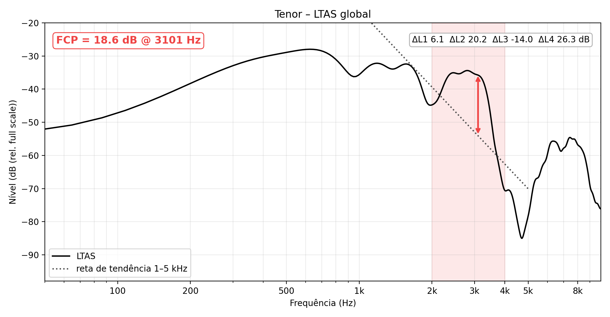
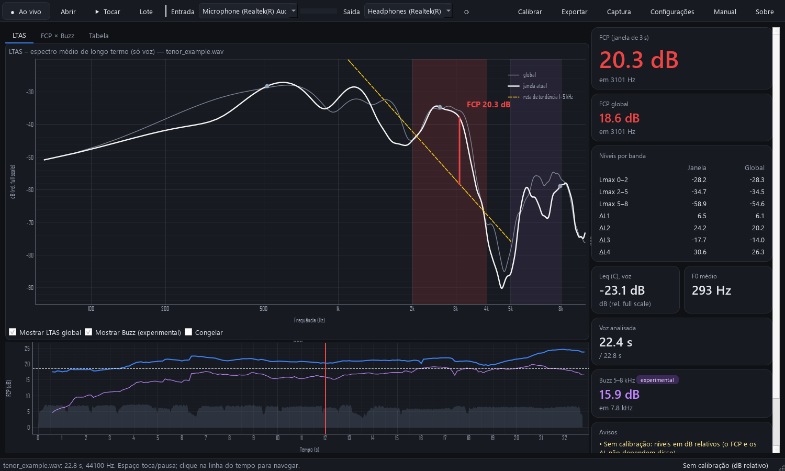
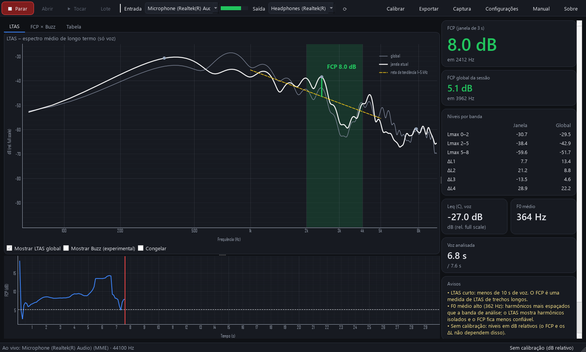

# FCP Live Analyzer 2.0 — Manual do usuário

Tiago Lima Bicalho Cruz · versão 2.0.0 · novembro de 2026

O FCP Live Analyzer mede, ao vivo ou em arquivos, a **Formant Cluster Prominence (FCP)**: quanto o
agrupamento das ressonâncias R3–R5 (o "formante do cantor") se destaca no espectro médio de longo termo
(LTAS) da voz. O programa segue a definição de Lã, Silva e Granqvist (2023) e mostra também as medidas
de banda do mesmo artigo (Lmax e ΔL1–ΔL4).

## 1. O que o programa mede

| Medida | Definição (Lã et al., 2023) |
| --- | --- |
| LTAS | Espectro médio de longo termo, só dos trechos vozeados. Janela Hanning, largura de banda de 350 Hz, média em potência. |
| Reta de tendência | Reta ajustada ao LTAS entre 1 e 5 kHz, linear em log da frequência (é reta no eixo logarítmico, como nas figuras do artigo). |
| **FCP** | **Maior diferença entre o LTAS e a reta, dentro de 2–4 kHz.** A frequência onde ela ocorre também é informada. |
| Lmax(0–2), Lmax(2–5), Lmax(5–8) | Nível máximo do LTAS em cada banda (kHz). |
| ΔL1 | Lmax(0–2) − Lmax(2–5) (índice de Hammarberg) |
| ΔL2 | Lmax(2–5) − Lmax(5–8) |
| ΔL3 | ΔL1 − ΔL2 |
| ΔL4 | Lmax(0–2) − Lmax(5–8) |
| Leq (C) | Nível equivalente com ponderação C, só da voz. Em dB SPL se o sistema estiver calibrado. |
| Buzz (experimental) | Medida própria do autor, **não validada na literatura**: percentil 90 do LTAS na faixa do Buzz (5–8 kHz por padrão) menos a reta de tendência avaliada em 5 kHz. |

Valores de referência publicados (Lã et al., 2023): leitura em voz alta ≈ 4–5 dB; Fado-Canção cantado ≈ 10 dB
(de 3,7 a 14,3 dB entre cantores); dois barítonos líricos 14,8 e 20 dB.

**Importante.** O FCP é uma medida de LTAS. Os autores afirmam que ele não se aplica a vogais sustentadas.
Use trechos de canto corrido, de preferência com pelo menos 10 s de voz.

## 2. Instalação e execução

* **Executável (Windows):** descompacte `FCP_Live_Analyzer_2.0.0_win64.zip` e abra
  `FCP_Live_Analyzer\FCP_Live_Analyzer.exe`. Não precisa instalar o Python.
* **Código-fonte:** com Python 3.10 ou mais novo, rode `pip install -r requirements.txt` e depois `python main.py`.
  Também dá para abrir um arquivo direto: `python main.py gravacao.wav`.

Formatos aceitos: WAV, FLAC, AIFF, OGG e MP3. Arquivos estéreo são convertidos em mono pela média dos canais.
Para medir até 8 kHz, use taxa de amostragem de 16 kHz ou mais (44,1 ou 48 kHz recomendados).

## 3. A tela principal

1. **Barra de ferramentas:** Ao vivo/Parar, Abrir, Tocar/Pausar, Lote, escolha de entrada (com medidor de
   nível) e saída de áudio, Calibrar, Exportar, Captura, Configurações, Manual e Sobre.
2. **Aba LTAS:** curva branca = LTAS da janela atual; curva cinza = LTAS global (do arquivo inteiro ou da sessão);
   linha amarela tracejada = reta de tendência de 1–5 kHz; seta colorida = FCP; faixa colorida = 2–4 kHz;
   pontos cinza = Lmax de cada banda; faixa lilás = banda do Buzz (se ativada).
3. **Linha do tempo:** FCP de cada janela (azul), Buzz (lilás, se ativado), FCP global (tracejado), envelope do
   sinal (cinza) e o cursor vermelho. **Clique em qualquer ponto para ir até ele.**
4. **Painel à direita:** FCP da janela, FCP global, tabela de Lmax e ΔL (janela e global), Leq, F0 médio,
   tempo de voz analisado, Buzz (se ativado) e **avisos** sobre a qualidade da medida.
5. **Aba FCP × Buzz:** dispersão das janelas, com o coeficiente r. O ponto vermelho é a janela atual.
6. **Aba Tabela:** todos os valores numéricos, com a definição de cada um.

As **cores do FCP** (azul < 5, verde 5–10, laranja 10–15, vermelho ≥ 15 dB) são faixas visuais escolhidas a partir
dos valores do artigo. **Não são limiares validados** de "presença" do formante do cantor.

Atalhos: **Espaço** toca/pausa, **←/→** volta/avança 1 s, **Home** volta ao início, **Ctrl+O** abre,
**Ctrl+L** ao vivo, **Ctrl+B** lote, **Ctrl+E** exporta, **F1** manual. Também dá para arrastar um arquivo para a janela.

## 4. Modo ao vivo

1. Escolha o microfone em **Entrada**. Confira no medidor que o sinal não chega ao vermelho (clipping).
2. Clique em **Ao vivo**. O LTAS e o FCP são atualizados 10 vezes por segundo, com cerca de 0,2 s de atraso.
3. O cartão **FCP (janela de 3 s)** mostra os últimos 3 s de voz. O cartão **FCP global da sessão** acumula
   toda a voz desde o início. Para comparar cantores ou tarefas, use o valor global.
4. Clique em **Parar**. A gravação é salva em `take.wav`, analisada de novo com o mesmo motor do modo arquivo
   e exportada para uma pasta `Live_AAAAMMDD_HHMMSS`. A gravação fica aberta para revisão sincronizada.

Os trechos sem voz (silêncio, consoantes surdas, respiração) são descartados automaticamente, como no artigo.

## 5. Arquivos e reprodução sincronizada

1. Clique em **Abrir** (ou arraste o arquivo). A análise roda em segundo plano, com barra de progresso.
2. O FCP global do arquivo aparece no painel. A linha do tempo mostra o FCP de cada janela de 3 s.
3. Clique em **Tocar**. O LTAS, os cartões e o cursor acompanham exatamente o que se ouve: a posição vem do
   próprio fluxo de áudio, já descontada a latência da placa de som. A janela mostrada é a dos últimos 3 s ouvidos.
4. Com o áudio parado, clique na linha do tempo para inspecionar qualquer momento.
5. **Congelar** mantém o gráfico parado enquanto o áudio continua.

## 6. Análise em lote

Clique em **Lote** e selecione vários arquivos. O programa cria uma pasta `Batch_AAAAMMDD_HHMMSS` com:

* `batch_summary.csv`: uma linha por arquivo, com os valores globais;
* `batch_windows.csv`: todas as janelas de todos os arquivos;
* uma subpasta por arquivo, com `summary.csv`, `windows.csv`, `ltas_global.csv` e os gráficos
  `ltas_global.png`, `fcp_timeline.png` e `fcp_vs_buzz.png`.

Um arquivo com erro não interrompe o lote: a linha dele traz `ERROR` na coluna `warnings`.

## 7. Calibração em dB SPL

O FCP e os ΔL são diferenças de nível e **não dependem de calibração**. Calibre apenas se quiser LTAS e Leq em dB SPL,
como no artigo:

1. Posicione o microfone e ajuste o ganho. Não mude o ganho depois.
2. Toque um tom estável (por exemplo 1 kHz) perto do microfone e meça o nível com um decibelímetro (ponderação Z ou C).
3. Em **Calibrar**, informe o valor lido e clique em **Gravar 3 s do microfone** (ou use um WAV do tom).
   O programa calcula o offset (dB SPL = 10·log10(potência) + offset). Também é possível digitar o offset.
4. Informe a **distância boca–microfone**. Os níveis são normalizados para 30 cm com 20·log10(d/30).

A calibração fica salva e vale só para o mesmo microfone e ganho. O programa avisa se você trocar de entrada.
Sem calibração, os níveis aparecem como "dB (rel. full scale)".

## 8. Configurações

| Opção | Padrão | Comentário |
| --- | --- | --- |
| Motor do LTAS | Tipo Sopran | Hann com largura de banda de 350 Hz e média em potência; curva contínua (pontos a cada ~20 Hz). |
| | Tipo Praat | Quadros de 40 ms, média em potência e média da densidade em faixas de 350 Hz, como o `To Ltas` do Praat (validado contra o Praat). |
| Largura de banda | 350 Hz | Valor do artigo. |
| Definição da banda | −6 dB | Janela Hann de 2·fs/B amostras (5,714 ms a 350 Hz), exatamente a janela que o Sopran mostra. Alternativas: −3 dB e ENBW. |
| Pontos usados nas medidas | Grade do Sopran | O FCP, a reta e os Lmax são calculados nos mesmos pontos de frequência do Sopran (FFT de 256 pontos a 44,1 kHz, ~172 Hz), o que reproduz os números do Sopran. A "grade fina" (~20 Hz) acha o máximo com mais precisão, mas pode dar alguns décimos de dB a mais. A curva desenhada é sempre a fina. |
| Janela do FCP dinâmico | 3 s | Só afeta a curva no tempo; o valor global usa o arquivo inteiro. |
| Só trechos vozeados | sim | Detector de F0 do Praat (60–1200 Hz). |
| Faixa do Buzz | 5–8 kHz | Também 4–8 e 5–9 kHz. |
| Idioma | inglês | Muda ao reabrir o programa. |
| Pasta de exportação | Documentos\FCP Live Analyzer\Exports | |

## 9. Arquivos exportados

`summary.csv` e `batch_summary.csv` (uma linha por arquivo):

| Coluna | Conteúdo |
| --- | --- |
| `duration_s`, `voiced_s` | Duração total e tempo de voz usado no LTAS |
| `level_unit` | Unidade dos níveis (dB SPL, dB SPL @30 cm ou relativo) |
| `Leq_C_voiced_dB`, `Leq_C_all_dB` | Leq com ponderação C da voz e do arquivo inteiro |
| `F0_mean_Hz`, `pitch_range_st` | F0 médio (geométrico) e faixa de F0 (percentis 10–90, semitons) |
| `FCP_dB`, `FCP_freq_Hz` | FCP e a frequência do máximo |
| `Peak_2_4_dB`, `Peak_2_4_freq_Hz` | Pico do LTAS em 2–4 kHz |
| `FCP_at_peak_v1_dB` | Definição antiga (pico menos reta no pico), só para comparação com a v1.x |
| `Trend_slope_dB_per_oct`, `Trend_intercept_dB` | Reta: nível = slope·log2(f) + intercept |
| `Lmax_0_2_dB`, `Lmax_2_5_dB`, `Lmax_5_8_dB` | Máximos por banda |
| `dL1_dB` … `dL4_dB` | ΔL1–ΔL4, com os sinais do artigo |
| `Buzz_experimental_dB`, `Buzz_experimental_freq_Hz` | Buzz (experimental) |
| `windows_n`, `windows_FCP_mean_dB`, `windows_FCP_sd_dB`, `windows_r_FCP_Buzz` | Estatísticas das janelas |
| `warnings`, `settings` | Avisos e todas as configurações usadas (JSON), para a análise ser reproduzível |

`windows.csv` tem as mesmas medidas por janela (`t_start_s`, `t_end_s`). `ltas_global.csv` traz o LTAS ponto
a ponto e a reta, prontos para abrir no Excel ou comparar com o Sopran. Os CSV usam vírgula como separador e
ponto decimal (no Excel em português, use Dados > De Texto/CSV).

## 10. Avisos e limites

| Aviso | O que significa |
| --- | --- |
| LTAS curto | Menos de 10 s de voz. O FCP fica sensível às vogais e notas do trecho. |
| Vogal/nota sustentada | A F0 quase não varia (menos de 2 semitons). O artigo diz que o FCP não se aplica a vogais sustentadas. |
| F0 médio alto | Acima de 350 Hz os harmônicos ficam mais espaçados que a banda de análise; o LTAS mostra harmônicos isolados (comum em sopranos). |
| Clipping | Mais de 0,1 % das amostras saturadas; os agudos ficam distorcidos. Reduza o ganho. |
| Taxa de amostragem baixa | Abaixo de 16 kHz, a banda de 5–8 kHz some (Lmax(5–8), ΔL2–ΔL4 e Buzz ficam vazios). |
| Sem calibração | Os níveis são relativos; FCP e ΔL continuam válidos. |

Outros cuidados: mantenha a distância e a posição do microfone, evite ruído de fundo e reverberação, compare
tarefas parecidas (o FCP também varia com a intensidade e com o ΔL1) e não interprete diferenças de 1–2 dB
entre dias sem repetir as medidas.

## 11. Validação

A pasta `tests` tem testes automáticos (rode `python -m pytest tests`). Entre eles:

* sinais sintéticos com envelope conhecido: o FCP medido bate com o FCP do LTAS teórico (±0,5 dB) nos dois motores;
* invariância: ganho e qualquer inclinação linear em log(f) não alteram o FCP;
* o FCP é o máximo de LTAS − reta, não o pico do LTAS;
* as definições de ΔL1–ΔL4 reproduzem as Tabelas 2, 3 e 4 do artigo;
* o motor tipo Praat coincide com o `To Ltas` do próprio Praat;
* trechos sem voz são excluídos; o modo ao vivo dá o mesmo resultado do modo arquivo;
* calibração, normalização para 30 cm e ponderação C;
* taxas de 16 a 48 kHz dão o mesmo FCP.

**Comparação com o Sopran** (o programa usado por Lã et al.). LTAS do arquivo inteiro no Sopran (Hanning,
350 Hz, janela de 5,7143 ms) e relatório de FCP do próprio Sopran, comparados com o app sem a remoção de trechos
não vozeados (como foi feito no Sopran):

| Arquivo | FCP Sopran | FCP app | Inclinação Sopran | Inclinação app |
| --- | --- | --- | --- | --- |
| ruído com cluster em 3 kHz | 10,15 dB | 10,16 dB | −11,488 dB/oit | −11,485 dB/oit |
| ruído sem cluster | 0,04 dB | 0,06 dB | −12,100 | −12,100 |
| tenor (exemplo) | 18,47 dB | 18,49 dB | −22,449 | −22,458 |
| rock (exemplo) | 2,93 dB | 2,95 dB | −9,206 | −9,207 |

A forma do LTAS coincide ponto a ponto (diferença menor que 0,6 dB de 0,3 a 8 kHz). Duas diferenças de
convenção, que não afetam FCP nem ΔL: (1) o Sopran mostra níveis 6,02 dB abaixo dos do app (o app usa o nível
de banda: um seno de −20 dBFS RMS lê −20 dB); (2) o Sopran rotula as frequências como k·fs/255 em vez de
k·fs/256, então a frequência do FCP aparece 0,4 % mais alta no Sopran (3112,9 Hz em vez de 3100,8 Hz).
Os dados e o script estão em `validation/sopran` e `tools/compare_sopran.py`; o teste `tests/test_sopran.py`
verifica essa concordância a cada versão.

## 12. O que mudou em relação à versão 1.2.1

| Item | v1.2.1 | v2.0 |
| --- | --- | --- |
| Definição do FCP | Pico do LTAS em 2–4 kHz menos a reta nesse pico | Máximo de (LTAS − reta) em 2–4 kHz, como no artigo |
| LTAS | Média dos espectros em dB, máximo em faixas de 350 Hz | Média em potência com janela Hann de 350 Hz (ou faixas tipo Praat) |
| ΔL nos CSV | Sinais invertidos; sem ΔL3; "Delta_2_4" era só Lmax(2–4) | ΔL1–ΔL4 com os sinais do artigo |
| Eixo de nível | Offset fixo de +94 dB, sem calibração real | Calibração com tom de referência, dB SPL a 30 cm, ou dB relativo |
| Ao vivo | Recalculava tudo a cada atualização; após 20 s, recalculava o sinal inteiro | Acúmulo incremental (~4 ms por atualização); global da sessão em tempo real |
| Reprodução | Exibição por temporizador, sem relação com a posição real do áudio | Exibição guiada pela posição do fluxo de áudio, menos a latência |
| Buzz | Várias versões, normalização ad hoc | Uma definição, rotulada como experimental, desligada por padrão |
| Vogais sustentadas | Exemplo com vogal sustentada | Aviso automático |
| Interface | Tkinter + Matplotlib | PySide6 + pyqtgraph, português e inglês |
| Licença | MIT e EULA contraditórias | Apache 2.0 com NOTICE (crédito obrigatório ao autor) |
| Dependência | `parselmouth` (pacote errado) | `praat-parselmouth` |

Para comparar resultados antigos e novos nos mesmos arquivos: `python tools/compare_v1.py arquivo.wav`.

## 13. Referências e licença

* Lã FMB, Silva LS, Granqvist S. Long-term average spectrum characteristics of Portuguese Fado-Canção from
  Coimbra. *Journal of Voice* 37(4):631.e7–631.e15, 2023.
* Sundberg J. Level and center frequency of the singer's formant. *Journal of Voice* 15(2):176–186, 2001.
* Sundberg J. The singer's formant revisited. STL-QPSR 36(2–3):83–96, 1995.
* Boersma P, Weenink D. Praat; Jadoul Y, Thompson B, de Boer B. Introducing Parselmouth. *J Phonetics* 71:1–15, 2018.

Licença Apache 2.0: uso, modificação e redistribuição livres, desde que o arquivo NOTICE e o crédito ao autor sejam
mantidos. Para citar o programa, veja `CITATION.cff`. Contato: fonotechacademy@gmail.com.
